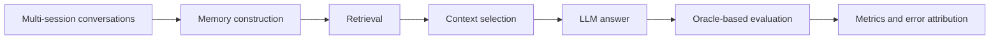

# Valutazione sperimentale della memoria persistente negli LLM per la personalizzazione di assistenti conversazionali

**English title:** Experimental Evaluation of Persistent Memory in LLMs for Conversational Assistant Personalization

Experimental framework for evaluating how external memory affects the ability
of Large Language Models to retrieve and use information distributed across
multiple conversations.

This repository contains the code, datasets, evaluation artifacts and results
developed for my Bachelor's thesis in Computer Engineering at Roma Tre
University.

## Project overview

LLMs mainly rely on a limited context window and may lose information when an
activity is distributed across separate conversations.

This project investigates how external memory can support conversational
continuity and personalization. It studies the effects of:

- memory availability;
- memory representation;
- memory sharing across different activities;
- replacing the generative model while preserving memory;
- the choice of the generative model.

Cybersecurity is used as the application domain for the controlled scenarios.
The project evaluates conversational memory and retrieval, not the general
cybersecurity knowledge of the models.

## What I built

- A Python framework for controlled LLM-memory experiments.
- Multi-session scenarios with manually defined evaluation oracles.
- Deterministic retrieval based on TF-IDF and cosine similarity.
- Multiple external-memory representations.
- Automated validation of scenarios, configurations and experimental artifacts.
- Evaluation of retrieval, answer correctness, correct abstention and
  unsupported claims.
- Error attribution across information availability, memory construction,
  retrieval and answer generation.
- Reproducible JSON and JSONL artifacts with configurations, manifests and
  frozen results.

## Memory configurations

| Configuration | Description |
|---|---|
| No memory | The model receives only the current question |
| Local memory | Retrieval is limited to the current conversation |
| Shared memory | Retrieval covers all conversations in the same activity |
| Turn-level RAG | Original conversational turns are retrieved |
| Fact-based RAG | Extracted facts are stored and retrieved |
| Update-aware memory | Facts can be added, updated, deleted or ignored |
| Graph-based memory | Information is represented through entities and relations |
| Hierarchical memory | Recent and archived information are managed separately |
| Full history | Diagnostic control using the complete conversation history |

## Experimental pipeline



## Research questions

| Research question | Focus |
|---|---|
| RQ1 | Does access to previous conversations improve answer correctness? |
| RQ2 | How does memory representation affect retrieval and answers? |
| RQ3 | What happens when different activities share the same memory? |
| RQ4 | Can conversational continuity be preserved after changing the model? |
| RQ5 | How much do results depend on the selected generative model? |

## Selected results

All results refer to the controlled experimental conditions of this project.

### Memory availability

In the initial pilot:

- session-local memory produced 5 complete answers out of 14;
- shared memory produced 11 complete answers out of 14;
- shared memory made the required evidence accessible for 12 questions out of
  14, with successful retrieval in 11 of those 12 cases;
- without accessible history, the model correctly abstained in all 14 cases.

### Shared and separated memory

Both separated and shared memory produced 120 correct answers out of 120 in the
RQ3 evaluation.

However, shared memory introduced 17 contaminating messages out of 240
retrieved messages, while separated memory introduced none. In this controlled
experiment, contamination did not produce final answer errors.

### Generative-model comparison

RQ5 evaluated 8,064 responses produced locally with Gemma 3 4B IT and
Llama 3.2 3B Instruct.

| Condition | Gemma 3 4B | Llama 3.2 3B |
|---|---:|---:|
| Exact match with sufficient context | 80.0% | 79.6% |
| Correct abstention with insufficient context | 85.4% | 75.7% |

The models obtained similar aggregate results when the required information was
available, but differed by 9.6 percentage points in correct abstention when the
context was insufficient.

Detailed tables and plots are available in
[`risultati_tesi/`](risultati_tesi/).

## Reproduce the core checks

The following commands use the saved experimental artifacts and do not call an
external model:

```bash
python3 scripts/validate_scenarios.py
python3 scripts/summarize_evaluation.py --check
python3 scripts/build_error_analysis.py --check
```

The first command validates the scenarios and their reachability matrices. The
other commands recalculate the pilot metrics and verify the causal attribution
of the observed failures.

Plot generation requires Matplotlib:

```bash
python3 -m venv .venv-grafici
.venv-grafici/bin/python -m pip install -r requirements-grafici.txt
.venv-grafici/bin/python scripts/plot_rq2_results.py --all
```

## Technology stack

- Python
- JSON and JSONL
- TF-IDF and cosine similarity
- Retrieval-Augmented Generation
- Ollama
- Gemma 3 4B IT
- Llama 3.2 3B Instruct
- Matplotlib
- `unittest`

## Repository structure

| Path | Content |
|---|---|
| `data/` | Scenarios, annotations, configurations and source datasets |
| `scripts/` | Memory construction, retrieval, generation and evaluation |
| `results/` | Execution traces and frozen experimental artifacts |
| `risultati_tesi/` | Compact result tables and plots |
| `pilot/` | Initial experiment on memory availability |
| `RACCOLTA_RISULTATI/` | RQ2 development results and evaluations |
| `tests/` | Validation and regression tests |
| `thesis/` | Bachelor's thesis PDF |
| `thesis_editorial_copy/` | Thesis-facing copies with descriptive organization names |

## Thesis

**Italian title:**  
*Valutazione sperimentale della memoria persistente negli LLM per la
personalizzazione di assistenti conversazionali*

[Bachelor's thesis — PDF in Italian](thesis/Giorgio_Lai_Bachelor_Thesis.pdf)

## Data and scenario names

The experimental conversations do not represent real corporate conversations.
Some scenarios use entirely synthetic data, while others are constructed from
public cybersecurity sources.

All organization names used in the scenarios are fictional.

The `thesis_editorial_copy/` directory contains editorial copies created for
the Italian thesis, where fictional organization names were replaced with
descriptive labels. No experiment, metric or evaluation was changed or
repeated.

## Limitations

- The results describe controlled experimental scenarios and should not be
  interpreted as universal rankings of models or memory architectures.
- RQ2 is exploratory and its comparisons are valid within each scenario.
- Full history is a diagnostic control and is not budget-matched with the
  retrieval-based configurations.
- The local-model comparison covers two quantized models.
- Most conditions use a single deterministic generation per evaluation cell.

## Documentation

- [Experimental design](EXPERIMENT.md)
- [Demo commands](COMANDI_DEMO.md)
- [RQ2 design and implementation](RQ2.md)
- [Compact result tables](risultati_tesi/README.md)
- [RQ2 result synthesis](RACCOLTA_RISULTATI/SINTESI_RQ2.md)

## License

The original software source code is available under the
[MIT License](LICENSE). Third-party datasets retain their upstream licenses;
their attribution, pinned versions and local license texts are documented in
[THIRD_PARTY_NOTICES.md](THIRD_PARTY_NOTICES.md).

The bachelor's thesis PDF is not distributed under the MIT license.

## Author

**Giorgio Lai**  
Bachelor's degree in Computer Engineering — Roma Tre University

Interested in applied AI, backend development, information retrieval and
evaluation of LLM-based systems.

[GitHub profile](https://github.com/giorgioL2003)
